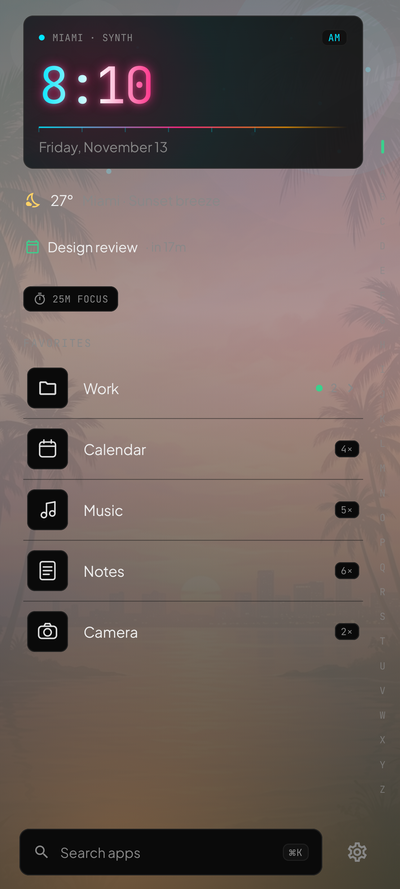
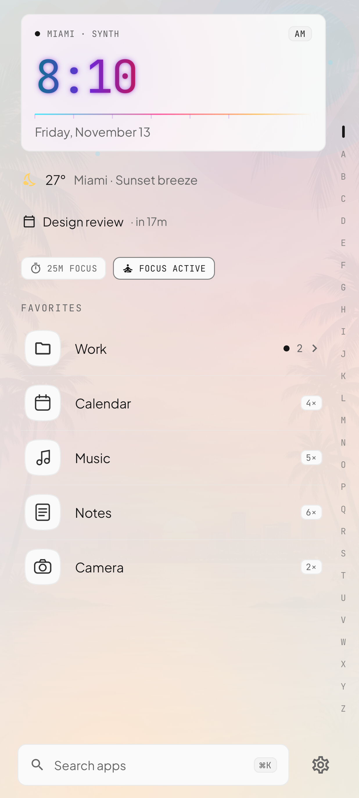
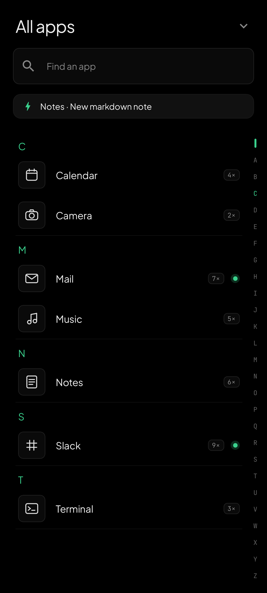
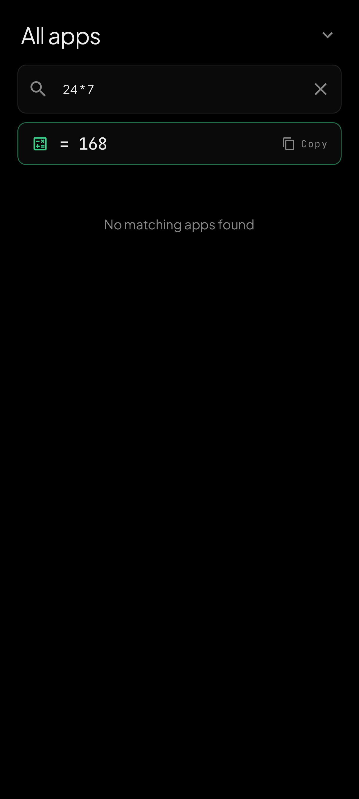
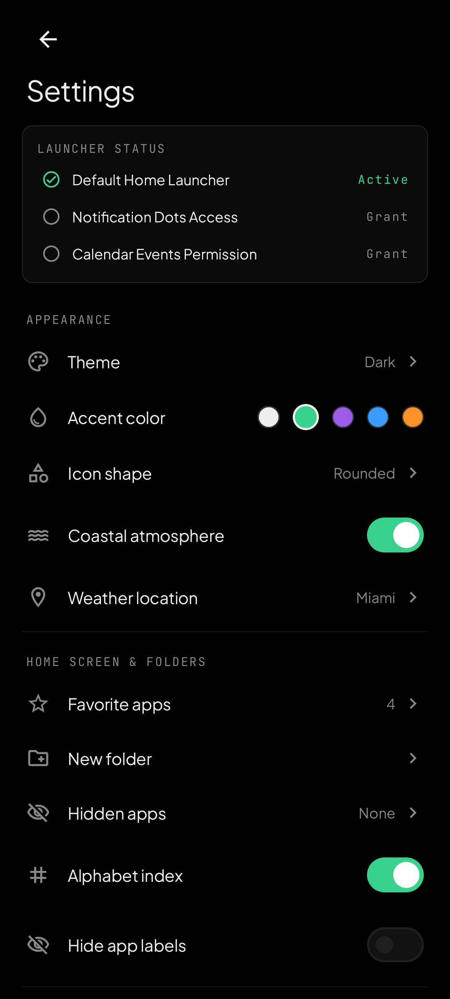

<div align="center">

# Vesper

**A minimalist, high-contrast Android home launcher pairing a Vercel-inspired Geist design system with a synthwave digital clock, gyroscope parallax sunset horizon, and mindful focus tooling.**

-3AD18D?style=flat-square&logo=android&logoColor=white)


</div>

---

## Screenshots

| Home (Dark · Synthwave + Sunset Parallax) | Home (Light · Geist Mono + Focus Active) | Command-K Drawer (A–Z + Shortcuts) | Command-K Drawer (Quick Math) | Geist Settings |
| :---: | :---: | :---: | :---: | :---: |
|  |  |  |  |  |

---

## Key Features

- **Vercel / Geist Design System**
  - Precision `1dp` hairline borders, `8dp`–`12dp` geometry, crisp typographic hierarchy (`Inter` + `JetBrains Mono` bundled locally), and five curated accent themes (`Emerald`, `Mono`, `Purple`, `Blue`, `Orange`) across Light, Dark, and System modes.
- **Synthwave Digital Clock Widget**
  - Neon cyan-to-magenta gradient digital time readout with multi-layer bloom, subtle breathing glow, perspective horizon beam, tap-to-open system Clock/Alarms, and `Reduced Motion` battery compliance.
- **Gyroscope-Driven Sunset Parallax**
  - Three-plane GPU-accelerated depth parallax across the sunset backdrop, upper solar bloom, and shoreline glow + weather effects (`Sensor.TYPE_GYROSCOPE` with automatic `TYPE_GRAVITY` / `TYPE_ACCELEROMETER` fallback on budget devices).
- **Adaptive Monochrome Outline Icons**
  - Automatically renders every installed app icon into crisp hollow monochrome line art inside your chosen frame shape (`Rounded`, `Squircle`, `Circle`, `Teardrop`), backed by a version-keyed PNG disk cache (`cacheDir/outline_icons/`) for instant cold starts.
- **Command-K (`⌘K`) App Drawer & Scrubber**
  - Swipe up anywhere or tap the `⌘K` pill to filter apps with zero-lag search, evaluate inline arithmetic (`24 * 7 = 168`, click to copy), detect phone numbers (`tel:`) and URLs (`https://`), launch app shortcuts, fall back to web search, or glide along the height-adaptive `A–Z` alphabet scrubber rail.
- **Expandable Home Folders & Quick Gestures**
  - Group favorites into inline expandable folders on the home screen, assign custom swipe-left, swipe-right, and double-tap actions, and pull down anywhere on the hero to expand the notification shade.
- **Focus Mode, Timers & Mindful Launch Pause**
  - Manual toggle, timed `15m / 25m / 45m / 60m` sessions, quiet-hours schedules (including overnight ranges), Essential Apps allowlisting, daily launch counters, and an optional breathing pause dialog before opening selected distracting apps.
- **Live Open-Meteo Weather & Calendar Preview**
  - Zero-API-key live weather & city search powered by Open-Meteo with offline JSON caching, coastal sky-tone interpolation across dawn/day/sunset/night, and an optional next calendar event preview.
- **Nuanced Hardware-Safe Haptic Feedback**
  - Context-distinct tactile triggers (`GESTURE_START` / `GESTURE_END`, `CLOCK_TICK`, `CONTEXT_CLICK`, `LONG_PRESS`, `CONFIRM` / `REJECT`) using `View.performHapticFeedback`—requiring **zero** `VIBRATE` permissions and honoring both system and in-app haptic toggles.
- **Portable JSON Backup & Restore**
  - Export, copy, share, or paste your complete launcher layout, folders, custom labels, focus rules, and theme preferences as versioned JSON.

---

## Low-End Device Performance

Vesper is engineered to remain fluid on entry-level and older Android 8.0+ hardware:

- **Zero-Recomposition Animations:** Gyroscope parallax and neon glow animations write directly into Compose `graphicsLayer { ... }` and `drawWithCache`, avoiding layout passes and per-frame object allocations.
- **Pre-Rendered Disk Outline Cache:** Adaptive icon perimeter extraction runs once per app version on `Dispatchers.IO` and persists compressed PNGs with SHA-256 cache keys.
- **Lifecycle-Aware Sensors & Timers:** Gyroscope/gravity listeners automatically unregister on `ON_PAUSE`, and clock/focus timers align to minute/second boundaries rather than polling.
- **Automatic Power-Save Awareness:** Respects both Android's Battery Saver / animator-duration scale and Vesper's in-app **Reduced Motion** switch.

---

## Architecture & Tech Stack

- **UI:** Jetpack Compose, Material 3, Edge-to-Edge `WindowInsets`
- **State:** Unidirectional MVVM (`LauncherViewModel` + `StateFlow` + `collectAsStateWithLifecycle`)
- **Storage:** Jetpack Preferences `DataStore` + internal disk icon cache
- **Networking:** `HttpURLConnection` + `org.json` on `Dispatchers.IO` (Open-Meteo weather & geocoding, zero heavy network SDK overhead)
- **Testing:** JUnit 4 + Robolectric 4.16.1 (`@GraphicsMode(NATIVE)`) + Compose UI Test

See [docs/ARCHITECTURE.md](docs/ARCHITECTURE.md) for the full package breakdown and data flow guide.

---

## Local Development, Versioning & Testing

### Prerequisites
- **JDK 21**
- **Android SDK** (`compileSdk 36`, `minSdk 26`, `targetSdk 36`)
- **Gradle 9.3.1** (or Android Studio / IntelliJ IDEA)

### Common Commands

```bash
# Run all unit tests and Robolectric Compose UI tests
gradle :app:testDebugUnitTest

# Run Android Lint checks
gradle :app:lintDebug

# Build a Debug APK
gradle :app:assembleDebug

# Build a Debug APK with custom semantic version overrides
gradle :app:assembleDebug -PappVersionName=1.0.1-dev -PappVersionCode=1000101

# Regenerate README screenshots directly from Jetpack Compose
GENERATE_SCREENSHOTS=true gradle :app:testDebugUnitTest --tests "com.example.ScreenshotGeneratorTest"
```

### Semantic Versioning
Default version metadata lives in [`version.properties`](version.properties) (`VERSION_MAJOR`, `VERSION_MINOR`, `VERSION_PATCH`, `VERSION_CODE`) and is automatically loaded by [`app/build.gradle.kts`](app/build.gradle.kts). Values can be overridden per build via Gradle properties (`-PappVersionName`, `-PappVersionCode`) or environment variables (`APP_VERSION_NAME`, `APP_VERSION_CODE`).

---

## CI/CD Pipeline

Vesper ships two GitHub Actions workflows:

| Workflow | Trigger | Actions |
| :--- | :--- | :--- |
| **Android CI** (`.github/workflows/ci.yml`) | `push` / `pull_request` on `main`/`master` | Runs unit + Robolectric Compose UI tests, Android Lint, builds versioned Debug APK (`<semver>-ci.<run>.<sha>`), calculates SHA-256 checksums, and uploads artifacts & reports. |
| **Release APK & AAB** (`.github/workflows/release.yml`) | Tag push `v*.*.*` or manual dispatch | Computes semantic `versionName` & monotonic `versionCode`, runs full test suite, signs Release `.apk` and `.aab`, generates `SHA-256` checksums, and publishes a GitHub Release. |

See [docs/RELEASING.md](docs/RELEASING.md) for signing keystore secrets setup and release instructions.

---

## Permissions

Vesper strictly follows least-privilege Android permissions:

| Permission / Capability | Usage | Optional? |
| :--- | :--- | :--- |
| `INTERNET` | Live Open-Meteo weather forecasts & city search | Offline fallback built in |
| `<queries>` intents | Explicit launcher & default-app discovery without `QUERY_ALL_PACKAGES` | Manifest queries |
| `EXPAND_STATUS_BAR` | Swipe-down gesture to open system notification shade | Yes |
| `READ_CALENDAR` | Next upcoming calendar event preview on home screen | Yes (runtime opt-in) |

> **No** `BIND_NOTIFICATION_LISTENER_SERVICE`, **no** `QUERY_ALL_PACKAGES`, **no** `VIBRATE`, **no** `READ_EXTERNAL_STORAGE` / media permissions, **no** location tracking, and **no** analytics SDKs.

---

## Documentation Index

- [Architecture Guide](docs/ARCHITECTURE.md)
- [Releasing & CI/CD Guide](docs/RELEASING.md)
- [Contributing Guide](CONTRIBUTING.md)
- [Changelog](CHANGELOG.md)
